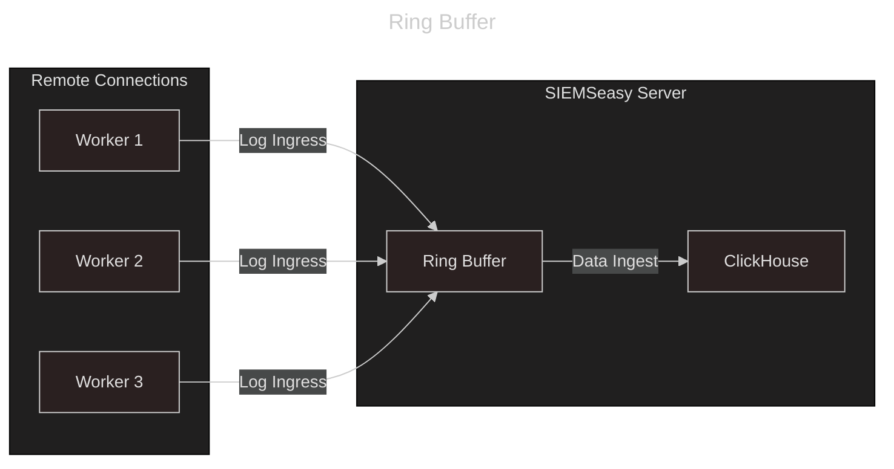

# Realtime Event Analysis Pipeline

This document talks about everything regarding SIEMSeasy's realtime analysis of
events. It should provide in-depth architectural review and decision making
process as well as the downsides and upsides of the existing implementation.

### Understanding the Ring Buffer

SIEMSeasy is a **concurrent** application first and foremost. Data can flow in and
out from different sources at different rates so a buffer is kept to ensure the
application can handle temporary bursts of traffic without buckling down. The 
data being transferred requires utmost integrity and cannot be tampered with at 
any cost.

Race conditions, dirty reads and lost updates are some of the most common problems 
in distributed systems and SIEMSeasy has addressed by implementing Vyukov's Bounded
Ring Buffer. It is extremely fast compared to other implementation because it
relies on atomic compare-and-swaps rather than locking access to the head and tail
pointers with a mutex which adds overhead and context-switching.

Each slot in the ring buffer acts as a small cycle state machine, marking whether
it is ready for reading or writing by a consumer or producer respectively. This
mitigates race conditions and dirty reads. If there are no more slots to write to,
writers will stall and let other goroutines move ahead. If all the slots are empty,
the reader will break early and return whatever data it gathered.

The queue I have implemented is an MPSC queue. Only enqueueing data to the ring
buffer performs atomic operation while dequeueing performs regular synchronous
operations. This is because there will be multiple simultaneous producers sending
data all at once while the data is being consumed by ClickHouse. Database writes
favour MPSC queues because returned data is far easier to batch data and the actual
network transmission can be handled asynchronously instead.

> [!WARNING]
> I have yet to benchmark the actual ring buffer and test for races but I
will hopefully once I have put all the individual pieces together.

